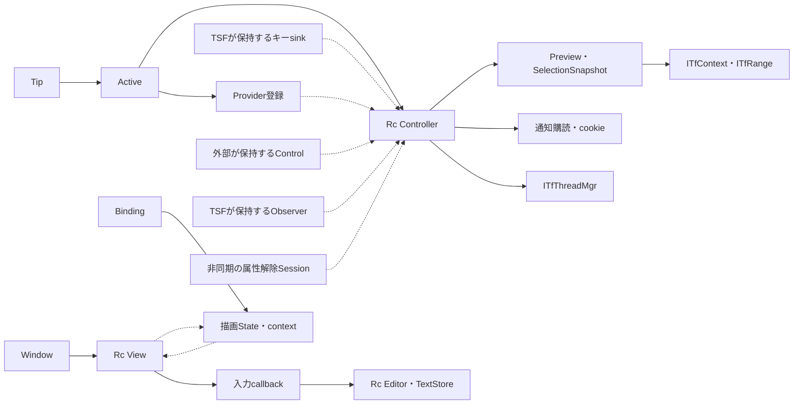

# Windows入力経路の責務と状態の寿命

2026-10-21。実装基準 `91552b0`。[全体設計](TECHNICAL_OVERVIEW.md)の所有関係を詳述する。
現行の検証用Controllerと、未実装の製品InputSessionを区別する。

## 1. 所有者と終了条件（現在の実装）

| 所有者・型 | 保持するもの | 終了・失効 |
| --- | --- | --- |
| setupのApartment・Library | COM STA、ロード済みDLL | 全COM参照解放とアンロード可能判定後にDLL解放、最後にSTA終了 |
| Tip / Active | 所有ThreadId、manager、clientId、キー登録、Controller、Provider登録 | Deactivateで許可失効と登録解除。失敗時は状態を残して再試行 |
| Controller | manager、許可context、EditPolicy、Preview、通知購読、解除世代、再入ガード | revoke・フォーカス喪失で書込権限を先に失効 |
| Delayed / Controllerの検証要求 | 弱Controller、単調時計期限、単調増加ID、保留ID | 取消・無効化で失効。旧応答で新要求を消費せず、取消後の選択再取得を禁止 |
| キーsink・Provider・Control | Controllerへの弱参照と独立のObjectLease | Controllerが消えたら操作しない。外部COM参照が残ればDLLの寿命は維持 |
| Observer / Subscription | 弱Controller、Sourceと購読cookie | closeでUnadvise。旧通知でも失効した対象へ書かない |
| SelectionSnapshot | context・range・選択style・原文・取得時policy・所有thread | 操作中に再検査。本文を持つためDebugを実装しない |
| Preview | snapshot、atom、activeフラグ、manager/client、OwnedComposition | cancel/commitで自分のcompositionを終了。解除拒否時は再試行情報を維持 |
| OwnedComposition | 自分で作成したCOM object、所有thread、寿命phase | identityの消失で強制終了を検出。別objectへ付替えず、workerへ渡さない |
| Session | one-shot処理、実行結果、所有thread、ObjectLease | コールバック一度。同期要求終了後の遅延本文操作は拒否 |
| TextStore | 合成本文、選択、sink、lock、Undo/Redo、検証用HWND | 専用文書終了。一般アプリの本文所有者ではない |
| Window / View | HWND、Frame、入力callback、refresh識別子、旧WndProc | WM_NCDESTROYでactiveを落とし、旧予約を無効化 |
| Binding | context、client、購読cookie、Scene、弱Viewへのrefresh handle | closeでactiveを落とし、表示を消し、購読解除 |
| Association | manager、文書、旧関連付け、弱View | 生存中のHWNDだけ関連付けを戻す。破棄後の同じHWND値へ触れない |
| Core InputSession / TrackedInput | 所有ホストの実入力UTF-16、範囲、context識別、通知世代と選択 | 不一致・境界・上限超過で消去。takeで一度だけ消費。Debug・永続化なし |
| setup Tracking / InputWatch | 所有STAのmanager/client、メタデータ通知購読、Core記録、自動選択の印 | 挿入前後とF7の検査。通知世代はラップしない。workerへ参照を渡さない |
| bridge InputCheck | 次のStartに限定する原文・範囲・保護状態の検査closure | 同期呼出し中に消費・解放。失敗時は予約も失効。F7終了・shutdownでも解除 |
| DLL Input Control / Tracker | 弱Controllerと独立lease、InputWatch、Core記録、自己所有composition、下線、1件の入力前状態とReady | 所有STAと再入ガード。Cancelで失効、cleanup拒否は最大1件保持。Readyはsource検査で一度だけ消費 |
| Input Monitor / EXE Signal | DLL側はwake先、EXE側はmanual-reset eventとactive/ownerだけ | 通知はsignalだけ。所有ループがPollし、終了時にsignalを無効化。本文・target・DLL callbackをeventへ持たせない |

## 2. 強参照と弱参照

実線は保持、破線は弱参照またはコールバック接続を示す。呼出し順の図ではない。

キーsink、通知sink、独立表示属性Info・Enumerator、編集SessionはそれぞれDLLのObjectLeaseを保持する。
Tipの参照が0でも、他のCOMオブジェクトやserver lockが残ればDllCanUnloadNowはS_FALSEになる。
Controllerへの弱参照とDLLロード寿命の計数は別の責務である。
図のViewとStateは互いを強参照しない。キューのメッセージにRcの生ポインターを積まない。
WndProcのuserdataはWindowが保持するViewを参照し、コールバック中の再入破棄に備えて一時的な強参照を確保する。

## 3. 所有スレッドと再入

TSF/COMの操作は生成時のスレッドに限定し、別スレッドは固定HRESULTで拒否する。
単発Brokerの検証経路はCOM参照を移動せず、要求IDと結果をeventで所有スレッドへ通知してそこで編集要求を行う。
専用所有contextのManualEdit/workerの起点は[ADR 0004](adr/0004-one-shot-broker-and-owner-edit.md)を参照。
現在のManualEditはgeneric ITfRangeを保持し、source前にcontext・端点・向きと保護状態を本文の再取得なしで検査する。
観測した失敗は復元後も失効し、finishは新しいwriteで全文も再照合する。
Coreへは絶対座標と区別した長さstampだけを渡す（[ADR 0018](adr/0018-retained-manual-range-and-source-validation.md)）。
実入力追跡はACP方式のままで、非ACPアプリの互換性は未検証。
協調する所有ホストは境界検出時にManualEdit.cancelで要求を明示失効できる。
所有threadだけの操作でCore保留と原文bufferを解放し、旧source/finishを永久に拒否する。
通信取消・予約/結果の解放は別に行い、callbackから待たない。
共通helperも保持したITfMessagePumpを受け取り、所有loopでだけ配送を進める
（[ADR 0020](adr/0020-owner-cancellation-and-shared-tsf-pump.md)）。
入力ホストはWM_KILLFOCUS・WM_ACTIVATEAPP(FALSE)・WM_ENABLE(FALSE)・WM_CANCELMODEで
Composing.owner_boundaryを呼び、再利用禁止と有限eventへの集約を行う。
所有loopでDLLへ取消を渡す。境界前の送信前checkerは世代の前後照合で拒否し、
復元・cleanup後も旧checkerを再利用しない。自然なOS通知だけの成立保証とは分ける。
同時に救済本文・途中surrogateとBroker grantを失効させる。境界の標準WndProc処理は維持する
（[ADR 0022](adr/0022-native-owner-window-boundaries.md)）。
実DLLのキー・Core・編集から診断用EXE bridgeを通す非同期経路も追加した
（[ADR 0005](adr/0005-dll-key-broker-bridge.md)）。workerはDLLへの参照やcallbackを保持しない。
単発ジョブの予約はworker・job・結果が共有し、最後の解放までprocess内4件に数える。
結果を取り出してjobを外した後のCOM再入でも、Completionが枠を保持する
（[ADR 0015](adr/0015-broker-admission-through-delivery.md)）。
worker専用Channelは同じ認証済み子とpipeを再利用し、Replyを保持している間は次要求を拒否する。
取消・通信失敗・期限で接続を閉じ、古い要求を再送しない。Channel/Replyは共通4枠を最後のDropまで保持する
（[ADR 0016](adr/0016-authenticated-reusable-broker-channel.md)）。connect/close/Dropにも待機があり、
Channelを既存のTSF callbackから直接呼ばず、EXE Workerの容量1 Command/Completionとeventで接続する。
Bridgeは取得前Permitを結果配送の最後まで保持し、配送中のReserve/drain/shutdown再入を拒否する。
起動・通信・子回収とChannelのDropはworkerへ限定し、facadeのDropでは待たない
（[ADR 0017](adr/0017-reusable-worker-and-owner-delivery.md)）。
製品InputSessionと一般アプリ内でのBrokerClientの配置は未実装。
さらにsourceを返す前と編集時に保護メタデータを再検査し、scope/compartmentの変更で要求を失効させる。
scopeのStampと通知、MSCTF内部読取との境界は[ADR 0006](adr/0006-input-protection-metadata.md)を参照。
同一contextのcompositionも拒否する。GUID_PROP_COMPOSINGで失効させ、空compositionの通知は
所有するTextStoreから既存Cancelへ転送する。一般ホストにこの協力を仮定しない
（[ADR 0007](adr/0007-foreign-composition-boundary.md)）。所有者callbackのCOM参照は終了時に解除し、workerには渡さない。
選択プレビューは自分のcompositionを開始し、終了後に従来の本文検査を行う。
診断ホストの共有EXE sinkにはDLL参照を持たせず、開始拒否でOS側に参照が残ってもDLLをpinしない。
強制終了のidentity検査と契約・制限は[ADR 0008](adr/0008-owned-selection-composition.md)を参照。
所有ホストの入力範囲を追跡するTrackingも追加した。通常入力はホストが一度だけ反映し、
挿入前後のメタデータ・通知世代をCoreへ渡す。F7の自動選択は一度だけ使い、
Startの同期検査で実DLLから渡された原文と照合してから全COM参照を手放す。
専用EXEが入力を観測できる前提であり、一般アプリの入力取得ではない
（[ADR 0009](adr/0009-cooperating-host-input-run.md)）。
composing-demoでは実DLLの独立ISpikeInputが同じcompositionの伸縮を担当する。
通常の本文取得はidleを必要とし、メタデータ照会だけが保持中の正確な1 objectを許容する。
生の通知世代とCoreの入力世代を分け、外部通知による不一致で旧記録を破棄する。
ホストの本文反映後にメタデータを更新する限定経路であり、原子的な本文入力取引は未完了
（[ADR 0010](adr/0010-cooperating-host-composition-growth.md)）。
InputWatch/ManualEdit Guardはstatus通知も購読する。外部通知をEXEのeventに集約し、
次の打鍵を待たず所有ループのPollで追跡を失効・cleanupする。
失敗直後の通知世代を保持し、同じ世代の再signalだけではwriteを再試行しない。
参照と終了後通知の扱いは[ADR 0011](adr/0011-owner-loop-input-invalidation.md)を参照。
transaction-demoでは独立ISpikeInputWriterが供給された文字を一度だけ挿入し、caretとcompositionを
同じ同期write cookieで更新する。scope/status/compartment/focusの履歴を自己OnEndEditと分けて検査する。
SetTextを試みた後の失敗ではHRESULTから再入力を推測せず、変換を停止して明示boundaryを待つ。
既存本文取得のidle gateは維持する。待機・救済・一般アプリ統合の完成ではない
（[ADR 0012](adr/0012-synchronous-input-transaction.md)）。
F7の準備は独立ISpikeInputPreparer::Prepare(context)で初回のowner/context/watchを検査・作成する。
明示選択は事前入力なしで扱い、SetSelectionで向きを変えない。記録なしのcollapsed caretは拒否する。
保護境界世代とReadyの通知世代を照合し、CheckSourceで一度だけ消費する。準備では本文を取得しない。
初回の選択準備はcompositionを開始せず、診断sink欠損でも成立する。入力compositionの製品寿命とは区別する
（[ADR 0026](adr/0026-initialize-explicit-selection-with-context.md)）。
transaction-demoのBackspaceは、Coreの記録範囲内だけから削除範囲を計算し、実DLLの独立
ISpikeInputEraserで削除・caret・composition縮小を同じwriteに接続する。全削除では自己objectを終了する。
現在の削除計画はUnicode 17.0.0の拡張書記素単位。Coreは記録UTF-16を固定scratchで分割し、
結合文字や複合絵文字をまとめて削除する。記録外の前後本文は取得・推測しない
（[ADR 0023](adr/0023-grapheme-backspace-within-recorded-input.md)）。
別途、ホストは自身の全本文からCore Boundariesを操作ごとに作り、左右/Shift移動とDeleteを計画する。
本文の借用は通知前に解放し、境界表は位置だけを保持する。ホストの編集と正式な通知で旧追跡/変換を失効させ、
DLLの本文取得範囲は広げない（[ADR 0024](adr/0024-grapheme-navigation-in-owned-host.md)）。
通常ホストのBackspaceもrepeat全体を変更前の選択・本文から一度だけ計画する。
DLLの書込前拒否/救済枠不足からのfallbackと旧composition観測経路の双方で、一度の編集とUndoにまとめる。
非空選択を消した後で残りrepeatを再計画せず、選択外の文字を巻き込まない。
未追跡の明示選択Deleteは独立ISpikeSelectionEraserで同期replaceへ接続する。
旧runを退役し、肯定的な保護検査と一時compositionの開始、空文字へのSetText、caretと終了を同じwriteで処理する。
本文を取得せず、削除後は空のInputSessionにする。救済はOperation::DeleteSelectionの操作情報だけでコピー不可。
書込前拒否/共有枠満杯だけを通常ホストへ返し、試行後の失敗は再削除しない。
明示選択Deleteの契約は[ADR 0025](adr/0025-synchronous-selected-delete.md)を参照。
本文書込と確定処理は挿入と共有する。追跡付きBackspaceで旧世代・記録外・他composition等の場合は一部を先に消さず、
書込前に元のホスト処理へ返す。試行後の失敗では再削除せず、明示boundaryまで変換を停止する。
記録内では独立ISpikeTrackedEditorが左右移動/前方Deleteを処理し、Coreはcaretと記録終端を分ける。
移動は同期SetSelectionだけ、削除はBackspaceと共通のerase/write_bodyで本文・caret・compositionを更新する。
移動/削除前に共有Recovery枠を予約し、試行後の失敗では元の操作を再送しない。救済は操作情報だけでコピー不可。
記録内repeatを全体として処理できない場合は退役して通常ホストへ戻す。内部caretのF7は記録全体だけを使う。
内部Backspaceも同じeraseで処理し、削除前後に残る記録を保持する。Coreは方向付きの計画/完了を共有し、
再結合した書記素を内部caretから削除する場合も全体を対象にする。旧Before/After観測のbackspacedは末尾限定のまま。
途中挿入は既存ISpikeInputWriterとCoreのinserted_at_caretで同じrunを継続する。
供給文字の前後を保持し、合計1024単位を超える場合は書込前に拒否する。旧観測用insertedは末尾追加の条件を維持する。
自己compositionの全範囲と保護/属性をcookie内で検査し、候補は本文・caret・compositionの検証後だけ公開する。
救済に渡す本文は新しい供給断片だけとする（[ADR 0029](adr/0029-tracked-internal-insertion.md)）。
記録内のShift選択は独立ISpikeTrackedSelectorと通常左右で共通のmove_selectionを使う。
Coreは記録だけから範囲と向きを計画し、InputMetadataはactive endpointを同期write前後とReady消費時に照合する。
SetSelectionだけで同じcompositionを保持し、通常左右での解除後も元のrunを継続する。
非空選択のF7は明示選択を優先する。共有救済のExtendSelectionは方向/countだけでコピー不可
（[ADR 0030](adr/0030-tracked-shift-selection.md)）。
記録内の非空選択はCoreのreplacement_range/replaced_selectionで前後の記録を保持する。
Writer/SelectionEraserは共通replace、Backspaceはeraseで同じcompositionを更新し、全削除だけ終了する。
容量は選択分を除いてから供給長を加える。選択Deleteは正確な観測と記録が一致する場合だけ継続し、
外部変更後の置換は新しい供給文字だけを記録する（[ADR 0031](adr/0031-recorded-selection-replacement.md)）。
専用単一行ホストの文書端操作は独立ISpikeDocumentNavigatorとCoreのEdgeMoveを使う。
GetStart/GetEnd/GetExtentだけで実contextの文書末尾を確認し、記録内にある場合だけ移動/Shift選択を継続する。
通常左右と同じ同期writeでSetSelectionを一度だけ行い、本文/Undo/compositionは変更しない。
文書末尾は計画時、write内の移動前後、PendingInputの完了時にも照合する。共有救済は本文のないMoveToEdgeを予約する
（[ADR 0032](adr/0032-recorded-document-edge-navigation.md)）。
一般アプリの行端/折り返し・キー配送と製品の待機/救済統合は残る。
所有editorの救済はCoreの1件・最大1024単位のslotを取引前に予約し、未確認結果だけを有限期限で保持する。
診断EXEは全Rescueへ同じBudgetを渡し、別STAも含む予約中/確認待ちを合計4件に制限する。
redactや画面の開閉では返さず、レコードの破棄・期限切れcleanup・所有者Dropで共有枠を戻す
（[ADR 0021](adr/0021-shared-input-recovery-budget.md)）。
UI callbackはticket付き操作のみを通知し、所有ループが期限・保護履歴を検査して明示コピー／破棄する。
TSF対象・cookieを救済へ保存せず、workerやIPCにも渡さない。本文書込や遅延キー再送は行わない。
保護変更やfocus喪失ではpayloadを除去する。一般アプリや製品の待機行列ではない
（[ADR 0014](adr/0014-bounded-input-recovery.md)）。
Controllerのbusyガードにより操作中の再入を拒否し、自分の書込で生じる通知を外部編集と誤認しない。
実験的なwaiting_input::WaitingInputはCOMを持たず、消費前admit・FIFO先頭の試行ticket・一度だけの完了を扱う。
Convertの新要求で排出を停止し、Enterは明示確認へ移す。対象/保護境界や不明完了からは再開しない。
後続の専用Waiting adapterはこのCoreと既存EXE共有Recovery予算を接続し、元入力の受入れ前に救済枠を確保する。
自己compositionは独立ISpikeInputState::Validateで実DLLの記録/identity/保護/通知と照合し、idle条件を緩めない。
確認済み変換後に所有caretを結果末尾へ移してから排出し、停止時は未適用tailと不明な先頭を区別する。
所有者Dropと取消は正確な要求IDを使う。waiting-demoのOwnerが専用の受付・複数救済UI・window通知を接続する
（[ADR 0033](adr/0033-bounded-core-waiting-input.md)）。
専用fixtureと寿命/容量の詳細は[ADR 0034](adr/0034-shared-recovery-waiting-adapter.md)を参照。
OwnerはSession/ViewをRefCellから取り出して外部処理を行い、再入境界はepoch/closedで公開と復元を止める。
UI操作はSession ID・固定index・slot ticketを照合し、旧行/旧Sessionを新しいレコードへ適用しない。
F8巡回と表示中の1件のコピー/破棄、Clipboard公開前の境界照合は[ADR 0035](adr/0035-waiting-demo-and-record-recovery-ui.md)を参照。
後続ではOwnerの1つのViewが待機レコードと通常Rescueをまとめて巡回する。
操作KeyはSourceで両者を区別し、待機側はSession/index、通常側はそのeditorのticketを照合する。
waiting-demoでは従来Rescueの独立UI serviceを実行せず、Ownerが保護/期限のmaintenanceと個別操作を呼ぶ。
保護後の本文なしの操作情報も表示/破棄でき、両者の最後の明示確認だけで失敗警告を解除する。
Clipboard公開前の期限と境界epochも検査する（[ADR 0036](adr/0036-unified-demo-recovery-and-copy-expiry.md)）。
F7要求の開始後にWaiting初期化が失敗した場合は捕捉した要求IDだけを取消し、
候補の公開前にDLL/Bridge保留ID・保護/選択/通知・境界epoch・終了状態を再照合する。
同一要求の重複通知はSessionを置換しない（[ADR 0037](adr/0037-cancel-failed-waiting-start.md)）。
通常救済だけが残る間もwaiting-demoのOwnerが表示中は1秒、非表示中は250ms以内に起床する。
本文の保護検査と残り時間の表示を更新し、記録がなくなれば周期起床を止める
（[ADR 0038](adr/0038-owner-wake-for-ordinary-recovery.md)）。
救済が期限切れで消えた後は通常のF7案内に戻さず、文書結果の確認を促す
（[ADR 0039](adr/0039-waiting-demo-recovery-loss-warning.md)）。
待機期限でも文書結果の確認を促す。未受入れ入力の通常経路へ移る際、専用対象と選択が安定し
結果未適用なら原文の選択末尾へcaretを移し、元のキーを一度だけホストへ渡す
（[ADR 0040](adr/0040-waiting-deadline-and-unadmitted-fallback.md)）。
TSFを呼ぶ前にRefCellの借用を解放し、通知やウィンドウ破棄が再入しても借用違反を起こさないようにする。

本文置換と属性解除の延期は区別する。属性解除は弱参照・世代一致を検査した上で非同期化できる。
本文置換は同期スパイクの完了条件を満たす場合だけ実行する。製品の非同期編集は別の期限付き要求として設計する。
同じ処理の再試行と、単なる読取確認も分ける。確認失敗を理由にSetTextを再実行しない。

## 4. 失効と後始末の順序

1. 許可・要求・プレビューを論理的に失効させ、本文書込を禁止する。
2. 候補などの表示を非表示にし、可能なら自分の属性だけ解除する。
3. ロック拒否なら解除だけを世代付きで予約し、古い予約が新対象に作用しないようにする。
4. 通知・Provider・予約キー・キーsinkを解除する。必要なcookieと参照は失敗時に保持する。
5. 文書とプロファイル・factoryを逆順に解除し、独立COM参照の解放を確認する。
6. DLLのアンロード可能判定が成立してからFreeLibraryを行う。

解除が失敗したときに権限を復活させない。Dropによる最善努力の後始末だけで、成功を保証したと記録しない。
setupは明示解除の結果を検査し、DLLを保持すべき場合は強制解放を避ける。
表示側もcloseで先にactiveを落とし、予約済みWM_APPの後着を無害にする。
HWNDが同じ整数でも別Viewなら別対象と扱う。

## 5. 製品InputSessionとBrokerの寿命（設計案）

| スコープ | 所有する状態 | 他スコープへ渡さないもの |
| --- | --- | --- |
| TSFスレッド | adapter、manager、client、入力先識別、所有スレッドへの結果配送 | 生COM参照・cookieをIPCやworkerへ渡さない |
| contextの接続世代 | 追跡、選択、原文アンカー、候補、保留要求、入力世代 | 別contextへ旧候補や救済文字を自動移行しない |
| 要求 | 一意ID、設定・認可版、取得原文、期限、結果の消費状態 | 接続し直したBrokerへ未完了要求を再利用しない |
| Broker接続 | nonce、起動世代、認証済みpeer、有限の未完了集合 | peerの本文を別接続の要求へ対応付けない |
| Broker全体 | 設定、資格情報、辞書、累積判定回数、自動処理の排他 | 資格情報をDLLや候補UIへ配布しない |

MacのInputRuntime.sharedは短命コントローラー再生成への対策だが、Windowsでプロセス共有の
単一入力状態を採用する根拠にしない。TSFスレッドとcontextの寿命を実測して管理する。
IUnknownの同一性と接続世代を組み合わせ、ポインター値の再利用や同じ原文の別欄を区別する。
対象変更・無効化・設定取消・IPC切断で要求を取消し、結果の配送先を検索して別欄へ適用しない。

## 6. 検証と残る確認

実装根拠は[com.rs](../crates/sumibi-tip/src/com.rs)、[spike.rs](../crates/sumibi-tip/src/spike.rs)、
[notifications.rs](../crates/sumibi-tip/src/notifications.rs)、[window_host.rs](../crates/sumibi-setup/src/window_host.rs)、
[live_render.rs](../crates/sumibi-setup/src/live_render.rs)。
COM単体試験とload_smokeは独立sink/Info参照によるアンロード阻止、再入・解除失敗を確認する。
window-testは旧属性解除、新描画Binding、破棄後予約、実フォーカス通知を確認する。
専用ACP storeでは非同期IPC後の所有thread編集、取消・終了・変更後の復元と失効をbroker-testで確認した。
一般アプリでのcomposition寿命、非同期IPCとの再入、終了直前の外部編集は未検証。
標準RichEdit自身のcontextでも拒否7構成を検証したが、隠し文字なしの保証がないため変換は未対応。
status診断は本文やCOMを保持せず、scope等の許可を代替しない
（[ADR 0019](adr/0019-native-richedit-status-diagnostics.md)）。
入力デモのWindowは所有managerのITfMessagePumpを保持する。
有限pump・blocking loopはこのwrapperを通してTSF通知を処理し、callbackではなく所有loopでcleanupする。
これらを実装する際は専用ホストで異常系を追加し、対象アプリの手動結果を別に記録する。
