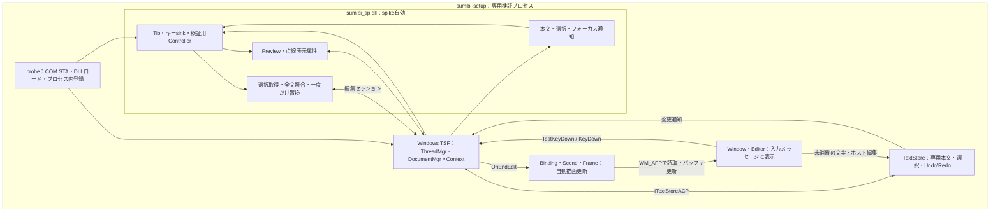
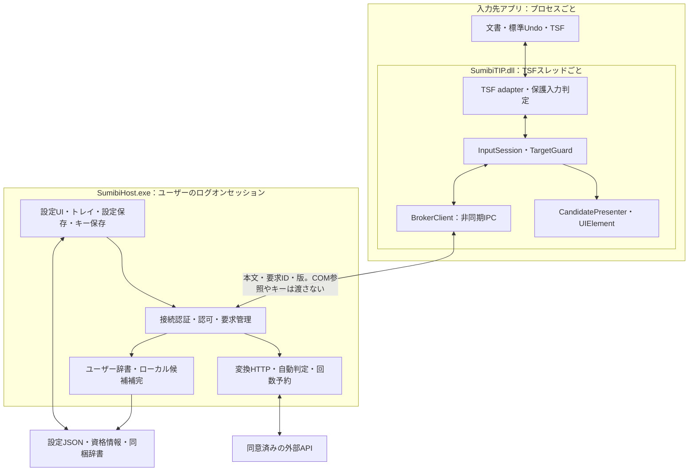
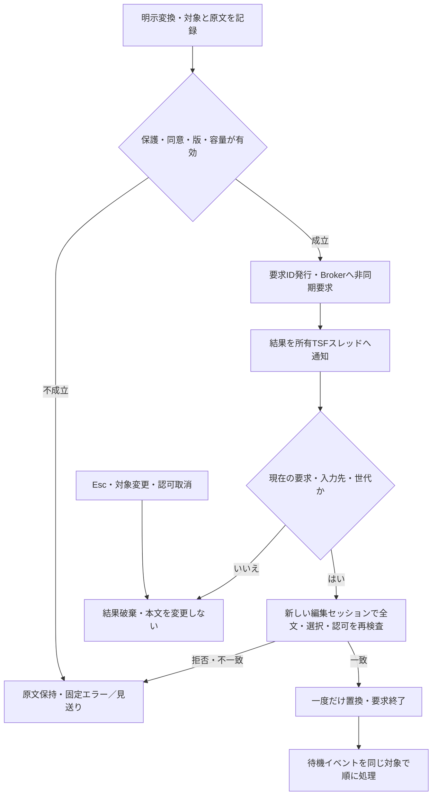
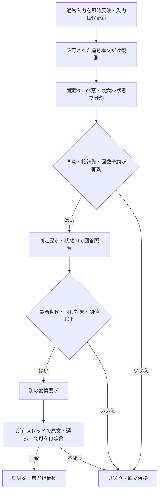

# Sumibi for Windows 全体設計

## 1. 文書の範囲と基準

2026-10-21作成。初版のWindows実装基準は `91552b0`（最小試作とIPC検証まで）。
Issue #4のJSON/client状態とsumibi-ipcの追加は[PR #10](https://github.com/kiyoka/Sumibi-win/pull/10)として追記している。
関連: [全体設計 Issue #3](https://github.com/kiyoka/Sumibi-win/issues/3)。
本書は実行時の構成、入力と変換、所有と寿命、保存と送信、異常系、配布までを扱う。
初期の採用判断は[DESIGN](DESIGN.md)と[ADR 0001](adr/0001-language-and-ime.md)、
実行手順は[DEVELOPMENT](DEVELOPMENT.md)、個別の成功記録は[TSF_SPIKE](TSF_SPIKE.md)へ分ける。

設計の粒度はMac版の[技術解説](https://github.com/kiyoka/Sumibi-mac/blob/553c69021eda7a8a5944d8748357f3790cc2f45c/docs/TECHNICAL_OVERVIEW.md)と
[所有・寿命の資料](https://github.com/kiyoka/Sumibi-mac/blob/553c69021eda7a8a5944d8748357f3790cc2f45c/docs/INPUT_CONTROLLER_ARCHITECTURE.md)に合わせた。
Mac参照コミットは `553c69021eda7a8a5944d8748357f3790cc2f45c`（確認時main）。
Mac技術解説自身の実装照合基準 `d2b96fc` と区別する。Macの機能やテスト件数をWindowsの実績へ転記しない。

本書の「実装済み」は専用検証プロセスでのコードを意味する。「設計案」は製品化時の契約案、
「未決」は実装前に検証・決定が必要な事項を意味する。文書作成だけでは製品仕様の合意や動作保証にしない。

| 領域 | 現在の記録範囲での状態 |
| --- | --- |
| Coreの応答適用判定・入力追跡 | 単一要求の照合と、所有ホストの実入力範囲の記録を実装。製品の通常入力全体の状態機械ではない |
| TIPのCOM・キー・表示属性・編集 | 専用ホストで実装済み。通常アプリへの常設登録なし |
| 入力保護 | scope/status/compartmentと取得・送信前・適用時の検査を実装。専用ACPで39ケース。status診断と標準RichEditの拒否7構成を確認（[ADR 0019](adr/0019-native-richedit-status-diagnostics.md)）。一般アプリの全機密欄の識別は未検証 |
| 入力・プレビュー・固定変換・Undo/Redo | 専用デモで実装済み。実キーボードの手動確認は未実施 |
| 追跡入力・composition・候補UI | 所有ホストの入力範囲25・実DLLのcomposition伸縮/初回選択46・選択composition 18・他サービス拒否16・同期入力取引148（選択Delete20・記録内移動/前方Delete26・内部挿入20・Shift選択27・記録内選択編集33を含む）・書記素Backspace 55（内部caret18を含む）ケースを確認。所有editorの救済45ケースとEXE共有4枠、window境界を含む通知30ケースも確認。専用ホストの書記素移動/削除22ケースも確認。Home/End等の追跡継続・待機・製品統合・候補UIは未実装 |
| Protocol / IPC | 有限フレーム・版付きJSON・client状態、固定process相互検査・overlapped pipe。実DLLのキー・Core・所有TSFから診断用EXE bridge経由で再利用Brokerへ接続。一般アプリは未接続 |
| Host・HTTP・キー保存・設定UI | 単発/有限連続要求の診断Host EXEを実装。既定では変換拒否。常駐Host・HTTP・キー保存・設定UIは未実装 |
| Decisions・辞書・署名付き配布 | 未実装。後続段階 |

## 2. 目的と不変条件

ローマ字や英語を入力し、必要な範囲をLLMで日本語へ変換するモードレスなWindows IMEを目指す。
初回は1候補を適用し、再変換で追加候補を得る。通常Enterを変換指示にしない。
Windows 11 x64の通常デスクトップ入力先から検証し、アプリ別の互換表で対応範囲を広げる。

実装の判断では次の条件を維持する。

1. 読取不能・対象不一致・保護条件不明の入力先へ結果を書かない。
2. 原文を消して通信を待たない。失敗・取消でも原文を保持する。
3. 応答は要求と対象を照合して一度だけ使う。取消通信の成功に安全性を依存させない。
4. TSFスレッドをHTTP・IPC待ちで止めない。編集cookieを通信待ちへ持ち越さない。
5. 本文・候補・秘密キーを通常ログへ残さない。送信先と同意を送信直前にも検査する。
6. キーを消費した場合の保持先と容量を確保する。別入力欄へ遅延キーを再生しない。

## 3. 現在の実行時構成

現在は開発ツール `sumibi-setup` が専用プロセス内でCOMクラスとTSFプロファイルを登録する。
このEXEは将来の通信Brokerではない。設定や実APIを扱わず、既定IMEを変更しない。

Coreの `ManualConversion` は上図の従来demoの固定変換経路には統合されていない。
別のbroker-testでは、setup所有STAにリンクしたManualEditがCoreを通し、別Hostからの固定結果を適用する。
この単発経路と寿命図は[ADR 0004](adr/0004-one-shot-broker-and-owner-edit.md)に分ける。
続いて実DLLのキーから診断用EXE bridgeを経由する経路を追加した
（[ADR 0005](adr/0005-dll-key-broker-bridge.md)）。この図の従来demoや、ネットワーク経路と区別する。

| モジュール | 現在の責務・コード |
| --- | --- |
| sumibi-core | [lib.rs](../crates/sumibi-core/src/lib.rs)：要求ID、対象、世代の完全照合。[input.rs](../crates/sumibi-core/src/input.rs)：実入力範囲の有限追跡。unsafe禁止 |
| sumibi-tip COM | [com.rs](../crates/sumibi-tip/src/com.rs)：factory、Activate/Deactivate、寿命計数、所有スレッド |
| キー・検証制御 | [keys.rs](../crates/sumibi-tip/src/keys.rs)、[spike.rs](../crates/sumibi-tip/src/spike.rs)：明示許可context限定、固定変換 |
| 編集・下線 | [edit.rs](../crates/sumibi-tip/src/edit.rs)、[preview.rs](../crates/sumibi-tip/src/preview.rs)、[display.rs](../crates/sumibi-tip/src/display.rs) |
| 変更通知 | [notifications.rs](../crates/sumibi-tip/src/notifications.rs)：本文・選択・フォーカス変更で失効 |
| 登録検証 | [probe.rs](../crates/sumibi-setup/src/probe.rs)：ローカル登録、障害注入、逆順解除 |
| 入力先・操作 | [edit_host.rs](../crates/sumibi-setup/src/edit_host.rs)、[input_host.rs](../crates/sumibi-setup/src/input_host.rs)：検証用TextStoreと1行Editor |
| 表示 | [live_render.rs](../crates/sumibi-setup/src/live_render.rs)、[render.rs](../crates/sumibi-setup/src/render.rs)、[window_host.rs](../crates/sumibi-setup/src/window_host.rs) |

## 4. 製品構成と責務の分離（設計案）

TSF DLLは入力先アプリのプロセスで動く。通信・保存・設定UIを別のユーザープロセスへ分離し、
入力先の停止やDLL更新の影響を抑える。これはMacの単一アプリ・単一プロセス構成からの意図的な変更である。

| crate / 所有者 | 契約 |
| --- | --- |
| sumibi-core | OS非依存のイベントと効果、手動／自動の状態、候補、上限判定。将来もunsafe禁止 |
| sumibi-protocol | 4バイト長＋最大256KiBのUTF-8フレーム、版付きの単一結果JSON、要求・接続世代・取消・期限・再接続。COM・HTTP・OS認証は含めない |
| sumibi-ipc | Windowsの固定process handle・token照合、合計8 endpoint、overlapped pipe・停止・期限。単発起動と容量4のworker。EXE再利用workerから認証済み子の連続要求と所有STA配送を検証（[ADR 0017](adr/0017-reusable-worker-and-owner-delivery.md)）。診断EXE bridge経由で実DLLキーとも接続。製品の一般アプリ内配置は未実装 |
| sumibi-tip | TSFキー、composition、範囲取得、保護判定、書込、候補表示、IPCの所有スレッドへの復帰 |
| sumibi-host | 現在は明示起動の単発/有限連続要求server、既定で変換拒否。製品では設定・同意・辞書の一貫した版、資格情報、HTTP、全体の自動要求制限を担当予定 |
| sumibi-setup | 現在は開発検証のみ。製品の登録・更新ツールと共用するかは配布ADRで決める |

入力先ごとのCOM参照をBrokerへ送らない。設定画面へ入力先本文を自動表示しない。
TSFオブジェクトの所有・再入・失効順序は[INPUT_CONTROLLER_ARCHITECTURE](INPUT_CONTROLLER_ARCHITECTURE.md)で定義する。

## 5. 通常入力・追跡・キー配送

### 5.1 現在の専用デモ

メッセージループはTSFのTestKeyDown/Upを先に呼び、要求された場合だけKeyDown/Upを呼ぶ。
消費済みならTranslateMessageを実行せず、WM_CHARの二重生成を防ぐ。
未消費の通常文字はホストのWM_CHARで編集し、ホストからTSFへ変更を通知する。

F6は自分のcontextを明示許可して選択範囲に下線を付ける。選択がなければ全文を選択する。
F7または許可された予約キーは固定の「日本語」へ変換する。LLM要求はない。
修飾なしEscは有効なプレビューを取り消して消費する。Enterは取消後に未消費で返し、
専用1行ホストが原文確認を一度だけ処理する。一般アプリの改行・送信を保証した検証ではない。

ホストの左右移動、Shift選択、Backspace/DeleteはUnicode 17.0.0の拡張書記素を使う。
内部caretは移動方向の書記素端へ寄せ、collapsed caretの削除は含まれる書記素全体を対象にする。
非空の明示選択は有効なUTF-16範囲を維持し、repeatで選択を広げない。Home/Endは文書端へ移動する。
選択の始点と移動端を区別し、`TS_AE_START/END`で向きを保存する。入力と削除後はカーソルを閉じる。
UTF-16上位サロゲートは下位が揃うまで保留し、不正な組合せは挿入しない。
1行・1024 UTF-16単位・固定サイズの表示に限定し、マウス選択・スクロールは未対応。
ホストのBackspace/Delete repeatは一度の編集とUndoにまとめ、明示選択の外へ繰り返さない。
Coreの位置だけの境界表とホスト編集の22ケースは[ADR 0024](adr/0024-grapheme-navigation-in-owned-host.md)を参照。
製品DLLの任意位置編集や前方削除取引の完成ではない。

追加のtracking-demoは所有ホストが実際に挿入した文字だけをCoreで記録する。
composing/transactionホストの明示選択は、context付きF7準備で初回入力前でも扱える。
準備は本文を取得せず、選択の向きと一度だけのReadyを維持する。記録のないcollapsed caretは拒否する。
初回選択ではcompositionを開始しないため、診断sink欠損でも成立する
（[ADR 0026](adr/0026-initialize-explicit-selection-with-context.md)）。
カーソルが有効な入力範囲の末尾にある場合だけ、F7でその範囲を選択して既存の非同期変換へ渡す。
移動・外部編集・保護変更等で無効になった範囲を復元せず、全文を推測しない。
明示選択は従来の選択変換を使う。入力反映自体はホストが一度だけ行い、追跡失敗で再送しない。
通知世代・composition counter・送信直前の原文完全一致を使う限定経路であり、
この経路自体はcompositionを更新しない（[ADR 0009](adr/0009-cooperating-host-input-run.md)）。
別のcomposing-demoでは、入力の前後を実DLLへ通知し、同じcompositionを文字入力で広げ、
Backspaceで縮める。本文はホストで一度だけ反映し、別の同期writeでメタデータだけを更新する。
F7前に自分のcompositionを終了し、通常の保護検査と原文の完全照合を通す。
このメタデータ専用の所有例外をGetTextの許可には使わない。
原子的なTSF本文入力取引や一般アプリの統合ではない（[ADR 0010](adr/0010-cooperating-host-composition-growth.md)）。
外部メタデータ通知はEXEのeventへ集約し、所有ループが次の打鍵を待たず古いcompositionを解除する。
statusの変更・復元もGuardで失効させ、同じ世代のwakeだけで拒否されたcleanupを繰り返さない。
通知callbackは編集・本文取得を行わない（[ADR 0011](adr/0011-owner-loop-input-invalidation.md)）。
transaction-demoでは供給された文字の挿入・caret・composition更新を同じ同期writeで行う。
書込前拒否と書込後の未確認状態を分け、後者では二重入力を防ぐため再入力せず、変換を停止して
確認を表示する。rollback・入力救済・製品の削除取引や一般アプリ対応の完成ではない
（[ADR 0012](adr/0012-synchronous-input-transaction.md)）。
記録内のBackspaceも、削除・caret・composition縮小を同じwriteで処理する。
記録済みUTF-16だけから拡張書記素単位で削除範囲を決め、全削除では自己compositionを終了する。
範囲越え等は部分削除せず書込前にホストへ返し、試行後の失敗では再削除しない。
記録と一致しない明示選択Deleteは独立ABIで同期writeへ接続し、本文・caret・一時composition終了を処理する。
旧追跡は退役し、削除本文を取得・救済コピーしない。書込前拒否と試行後失敗を区別し、再削除を防ぐ
（[ADR 0025](adr/0025-synchronous-selected-delete.md)）。
記録内の左右移動と前方Deleteも独立ABIで実DLLへ接続する。caretと記録終端を分け、内部caretのF7は
記録全体だけを変換する。移動は本文/Undoを増やさず、削除は同じcompositionを縮める。
境界越えや未知の追跡は退役し、試行後の失敗では元の操作を重ねない
（[ADR 0027](adr/0027-tracked-caret-and-forward-delete.md)）。
内部Backspaceは前方Deleteと方向付き計画を共有し、削除前後に残る記録を同じcompositionで保持する。
旧ホスト観測用の末尾限定APIとは分離する（[ADR 0028](adr/0028-tracked-internal-backspace.md)）。
途中挿入も既存Writerで記録全体を継続し、合計容量とscalar境界を検査する。既存本文は取得せず、
供給断片だけを一度挿入し、同じcompositionを広げる（[ADR 0029](adr/0029-tracked-internal-insertion.md)）。
記録内のShift＋左右も同じcompositionを保ち、選択のanchorとactive endpointを維持して拡縮/反転する。
通常左右で選択を解除した後も入力を継続でき、非空選択のF7は選択部分だけを変換する。
向きは端点とは別にInputMetadataとReadyで照合する（[ADR 0030](adr/0030-tracked-shift-selection.md)）。
記録内の選択置換・Delete・Backspaceは同じcompositionと前後の記録を保ち、全削除では終了する。
選択範囲を拡張せず、供給長と削除長から全範囲と容量を照合する。失効した選択は旧runを継続せず、
新しい供給文字だけを記録できる（[ADR 0031](adr/0031-recorded-selection-replacement.md)）。
Home/End等の追跡継続と一般アプリ対応は未完了。同期取引は[ADR 0013](adr/0013-synchronous-tracked-backspace.md)、
分割版・記録境界とfallbackは[ADR 0023](adr/0023-grapheme-backspace-within-recorded-input.md)を参照。

### 5.2 製品の追跡入力（未実装）

TSF compositionの開始／終了、通常文字の反映、下線属性、追跡範囲の更新を一つの入力取引として扱う。
文字を消費してから書込権限を探す順序にせず、反映可能性を確保できない場合は元イベントを通す。
他IMEのcompositionや外部編集を取り込んで追跡を継続しない。境界・移動・文書切替で追跡を終える。

Ctrl+Jはスパイクの予約キーで、最終割当はUS/JIS配列とアプリ競合で決める。
Macの右Command短押しを右AltやWindowsキーへ置換しない。F6/F7も検証操作で、製品キー仕様ではない。
候補表示中以外の標準Undo/Redoや移動キーをTIP独自操作へ置き換えない。
入力スコープの判別不能時、読取専用、パスワード、無効context、対象外アプリでは追跡・収集を開始しない。

## 6. 選択取得と編集取引（実装済み）

1. 所有スレッドと許可を検査し、同期read編集セッションを要求する。
2. 現在のフォーカスcontext、選択の範囲と向き、対象全文、ポリシー版を記録する。
3. 対象全文を分割読取し、進捗・総容量・UTF-16を検査する。部分文字列だけの一致を認めない。
4. 別の同期write編集セッションで、フォーカス・選択・範囲・全文・ポリシーを再照合する。
5. 成立する場合だけSetTextを一度呼ぶ。編集セッションの後へ置換本文を持ち越さない。

`RequestEditSession`自身の成否、内側のHRESULT、実コールバック実行を区別する。
one-shotの処理と完了フラグを持ち、未実行・遅延コールバック・二度目の実行で本文を書かない。
同期編集が拒否されたとき、同じ置換を後から無条件に再試行しない。
APIの同期／非同期指定は[Microsoftの契約](https://learn.microsoft.com/en-us/windows/win32/api/msctf/nf-msctf-itfcontext-requesteditsession)に従う。

現在の1024 UTF-16単位はアダプターの技術上限で、後述する送信1000書記素の上限と別である。
Coreの`Target`はcontext/rangeの不透明ID、選択、UTF-16全文、入力・設定・認可の版、allowedを持つ。
選択は絶対ACP座標と保持rangeの長さstampを明示的に区別する。
ManualEditはgeneric ITfRangeのcontext・端点・向きを所有STAで検査し、長さstampを使う。
source前のmetadata検査で失敗した要求は復元後も再利用できない。
非ACPアプリの互換性は未検証で、実入力追跡はACP方式を維持する
（[ADR 0018](adr/0018-retained-manual-range-and-source-validation.md)）。
同じ要求の応答は照合失敗でも消費するが、別要求の古い応答で現在の要求を消さない。
ManualEdit.cancelは所有ホストの明示境界で保留要求と原文bufferを解放する。
source/finishを永久に拒否し、再開には新IDでcaptureする。通信停止は別に所有側で行う
（[ADR 0020](adr/0020-owner-cancellation-and-shared-tsf-pump.md)）。
ManualConversionのTargetには独立の容量制限を設けず、呼出し側が上限を担う。
追加のCore InputSessionは所有ホストの入力範囲を1024 UTF-16単位に制限する。
製品の追跡入力全体や待機・救済の処理ではない。

## 7. 下線・通知・描画（実装済み）

`Preview`はスナップショットと表示属性atomを保持し、編集セッションをまたいで点線を残す。
既存の別属性がある範囲では開始を拒否する。取消は自分のatomと記録範囲に属する属性だけを解除し、本文を変更しない。
確定は再照合・自分の属性解除・最終照合・SetTextの順とし、成功した本文書込の後に失敗し得る処理を置かない。
2026-10-22、Previewに自分の選択compositionも追加した。確定は所有objectの存続確認・終了を先に行い、
その後で従来のidle条件と本文再照合を行う。取消も自分のcompositionと属性だけを解除する。
強制終了後の別objectを同じ範囲・原文で再利用せず、開始拒否時にもDLL参照を残さない診断ホスト契約を使う
（[ADR 0008](adr/0008-owned-selection-composition.md)）。製品の通常入力追跡の実装ではない。

本文／選択変更やフォーカス喪失では先に適用権限を失効させる。
通知中に書込できなければ、自分のcompositionと下線の解除だけを非同期writeセッションへ予約する。
弱参照とプレビュー世代で古い解除を拒否する。取消直後に新しいプレビューを始めても旧予約で消さない。
解除ロック拒否時は情報を保持して再試行できるが、無効化済みの本文置換は許可しない。

表示属性は細いDOT、文字色・背景色の指定なし。一般入力先が同じ見た目で描くことは未検証。
検証ホストは実DLLから属性定義を取得し、GDIのメモリーDIBへ描く。
OnEndEditでは読取せず、集約したWM_APP要求から同期read、Scene生成、Frame更新へ進む。
WM_PAINTはキャッシュだけを表示し、編集セッションを要求しない。
読取失敗時は古い本文・下線の画面を消し、次の通知で回復する。
接続ごとの識別子と弱参照により、再接続・ウィンドウ破棄・HWND再利用後の予約を捨てる。

## 8. 手動変換・追加候補（設計案）

開発用の`ISpikeDelayed`で、実DLLへの要求ID・単調時計期限付き固定応答を検証済み。
別threadはCOMを保持せず、有限channelとフレームで合成応答だけを返す。
取消・期限切れ・別欄・新要求への遅延応答は非適用にする。製品のCore/IPC/HTTP経路は未統合。
11ケースの条件は[Issue #1受入記録](ISSUE_1_ACCEPTANCE.md)を参照。

要求開始時に保護判定と認可を確認し、原文と正確な対象を保持する。
追跡compositionを確定してから対象を取り直す経路と、既存の選択を直接対象にする経路を分け、
Macの同一文字列による確定書込を機械的に追加しない。不要な書込によるUndoの増加を避ける。

sessionId/requestIdはプロセス再起動・Broker再接続をまたいで再利用しない。
Broker起動世代も照合する。IPC切断時は未完了を取消し、再接続で旧要求を自動再送しない。
通常の非同期応答では所有スレッドへ戻して新しい編集要求を行う。許される要求モードはTSFスパイクで確認する。
現在の同期編集ヘルパーをそのまま任意のIPC通知から呼べるとはみなさない。
延期を認める場合も、期限と現在要求の検査をコールバック内で行う。初期案では適用拒否後の本文再試行を行わない。

初回は1候補を適用する。再変換は元原文と現在結果で追加要求し、現在結果を先頭に置く。
追加取得中は現在本文を維持し、取得成功だけでは置換しない。選択時に対象を照合して置換する。
Mac実装の最大12候補とSPECの追加10件の差は[移植表](MAC_PARITY.md)へ残し、Windows製品の件数を未決とする。
応答解析は空・重複・上限・不正構造を検査し、件数を満たす自動再要求をしない。

### 8.1 待機入力と救済

手動要求中の文字・Backspace・Enter・Convertを順序付きイベントとして保持する案。
消費前に容量を確保し、次の要求が始まったら排出を止める。対象変更後の別欄には排出しない。
遅延Enterなどホスト制御キーは自動再送せず、未適用の固定表示へ移す。SendInputで補わない。
通常Enterのその場の通過と、待機中に消費済みのEnterを区別する。

提案上限は1024イベントかつ本文16384 UTF-16単位、救済本文はプロセス合計16384単位・10分。
製品の期限切れ破棄の事前表示と明示操作の関係は未決で、製品の待機入力へ自動破棄を有効にしない。
容量超過では要求を取消し、安全に元欄へ原文を反映するか、消費前に通過へ切り替える必要がある。
この切替と容量確保を証明できるまで、製品用の待機キー消費を有効化しない。
救済はメモリーに限定し、明示コピー・破棄だけを提供する。クラッシュ後の本文復元は保証しない。

診断editorでは上記の製品提案と分けて、1件・1024 UTF-16単位・10分の救済を実装した
（[ADR 0014](adr/0014-bounded-input-recovery.md)）。文字挿入／Backspaceの取引前に容量だけを予約し、
結果不明／適用後追跡失敗の場合だけ保持する。保護履歴と新しいmetadata検査に失敗すれば本文を保存しない。
F8で明示確認し、確認画面からF10でコピー、F9で破棄する。文書への自動適用や待機キーの再送はしない。
診断経路では期限による自動破棄を事前表示し、ownerの期限待機で解除する。製品の全体予算・期限政策は未決。
診断EXEには別途共有Budgetを追加し、予約中を含め全editor合計4件（レコード本文合計4096単位）とする。
本文を除去した警告も数え、他所有者の枠が満杯なら書込前に元のホスト入力へ返す。
期限切れの容量はそのownerのcleanupで戻し、別ownerが本文を取得・再適用することはない。
UIやコピーの一時bufferはこの本文上限とは別で、製品案やプロセス間の予算には読み替えない
（[ADR 0021](adr/0021-shared-input-recovery-budget.md)）。

## 9. Decisions自動変換（後続設計）

手動経路完成後に導入する。Macの自動変換は参照契約であり、現時点のAPIやモデルの利用可能性を保証しない。
実装着手時に公式仕様とモデル・料金・応答形式を再確認し、API契約を別ADRへ固定する。

自動中のキーを手動待機行列へ入れない。観測キューはキー再生ではない。
提案値は未送信256状態、1状態512書記素、閾値0.5、判定10秒、累積判定HTTP10000回。
窓は後続入力で延長せず、キー受信時にも単調時計で期限を確認する。
Broker全体で自動処理を1件に直列化し、手動要求を優先する。入力先切替で古い観測を捨てる。
回数は送信前に永続予約し、取消・失敗でも戻さない。保存失敗や上限時は送信しない。
アプリ再起動や接続増加で上限を超えず、明示リセットだけを認める。回数は請求額ではない。

自動は既定オフで、手動の送信同意と別の同意を持つ。公式接続先専用とし、カスタム接続先のキーを流用しない。
回答は名前集合・重複・件数・型・有限の0〜1の値を検査し、配列順だけで入力に対応付けない。
適用後の読取確認が必要でも結果を再書込しない。Macの読取待機時間や相対座標補正をWindowsへ直接移さない。

## 10. 候補UI・辞書・Undo

### 10.1 候補表示（未実装）

候補Presenterは対象世代と選択状態を持ち、表示層はフォーカスを奪わない。
TSF UIElementのBegin/Update/Endと候補リストの契約を実装し、ホストが描画を担当する場合に独自窓を出さない。
これは[BeginUIElementの表示指示](https://learn.microsoft.com/en-us/windows/win32/api/msctf/nf-msctf-itfuielementmgr-beginuielement)に基づく設計。
キー移動・数字選択・クリック・Escの優先順位、DPI・複数モニター・読み上げ・高コントラストを受入項目にする。
座標取得失敗時は推定位置へ本文を書かず、候補表示の抑止と固定の案内に留める。

### 10.2 辞書（未実装）

登録ユーザー辞書と同梱候補索引を別に扱う。登録辞書は「よみ = 変換後」形式、100件・保存2000書記素の案。
読みの形式・空行・重複を保存時に検査する。初回／追加の変換へ添付するため、保存可能でも送信上限超過はあり得る。
同梱索引は追加候補成功後に、中黒・Mozc記号・Sudachi同音異義語の順に最大10件を補完する案。
元入力の完全一致と、ひらがな候補の読み検索を区別し、LLM候補の順序・出所・重複優先を維持する。
索引全体を送信せず、API失敗時のオフライン代替にしない。
固定元データ・生成手順・ハッシュ・LICENSEを同梱し、記号の字形画像やフォントをコピーしない。

### 10.3 Undo/Redo

製品TIPは入力先の標準履歴を使用する。初回変換と候補切替がそれぞれ1回のUndoで戻ることを受入目標にする。
アプリごとに取引単位を検証し、クリップボードや疑似Ctrl+Zで補わない。

専用TextStoreでは本文・選択・向きを対で保存し、Ctrl+Z/Ctrl+YでUndo/Redoする。
新規入力・削除・TSF SetTextはRedoを破棄する。移動やプレビューだけでは破棄しない。
読取専用・ロック中は履歴を消費せず、本文と選択を揃えてから通知する。
履歴に下線属性を保存せず、Undo/Redoで無効なプレビューを復活させない。
これはデモホストの履歴であり、DLLが一般アプリのUndo/Redoを実装した意味ではない。

## 11. IPC・認証・障害境界（設計案）

実装済みの外側フレームは[IPC_PROTOCOL](IPC_PROTOCOL.md)、SID限定pipeの同一プロセス検証と
AppContainerの初期非対応判断は[ADR 0002](adr/0002-ipc-boundary-and-desktop-probe.md)を参照。
型付きメッセージとclient状態はIssue #4の最初の段階で追加した。固定した起動process間のOS相互検査と
overlapped pipeも追加した（[ADR 0003](adr/0003-pinned-desktop-peers.md)）。
単発Hostと所有TSFへの配送は専用ACP storeで検証した（[ADR 0004](adr/0004-one-shot-broker-and-owner-edit.md)）。
実DLLキーからの診断用bridgeと非同期デモも追加した（[ADR 0005](adr/0005-dll-key-broker-bridge.md)）。
製品の常駐Broker・発見・一般入力は未完了。
現在の正確な版1の形式・上限は
[IPC_PROTOCOL](IPC_PROTOCOL.md)を参照。以下の相互認証と製品接続は設計案で、pipe probeだけでは検証済みとしない。
下表は候補等も含む製品案であり、実装した版1は単一の変換要求／結果に限定する。

通常デスクトップの第一候補はローカルnamed pipe。対象ユーザーとログオンセッションの明示DACL、
リモート拒否、サーバー／クライアントのトークン・セッション確認を組み合わせる。
既定のpipe ACLをそのまま使わない。[アクセス制御の根拠](https://learn.microsoft.com/en-us/windows/win32/ipc/named-pipe-security-and-access-rights)。
パイプ名を知っているだけでは認証とみなさず、同一ユーザーの侵害プロセスに完全耐性があるとも説明しない。
具体的なトークン検証、偽サーバー対策、起動ハンドシェイクは実装前のIPC ADRで固定する。

| メッセージ | 内容・受信側の条件 |
| --- | --- |
| Hello / Ready | protocol版、Broker起動世代、接続nonce、認可済み設定版。互換性不成立なら本文を送らない |
| Convert | sessionId、requestId、入力／設定／認可版、操作種別、原文、必要時の現在結果 |
| Cancel | 同じ接続・セッション・要求の取消。存在しない要求にも安全な冪等処理 |
| Result / Error | 対応ID・版・候補または固定分類。完了後の重複を適用しない |
| PolicyChanged | 設定・認可版と許可状態。旧版の未送信要求をBroker側でも拒否 |

COM参照・cookie・TSF座標・APIキー・アプリ名はConvertへ含めない。
原文はUTF-8へ厳密変換し、4バイトlittle endian長＋最大256KiB本文とする。外側フレームと単一結果のJSONは実装済み。
整数の範囲・必須フィールド・候補件数・文字列長・総容量も検証し、未対応版は拒否する。
切断・不正フレーム・過大要求は要求を終端化し、本文をログに出さない。
受信数・未完了数・出力バッファは有限にし、具体値は負荷試験とともにProtocol仕様へ固定する。
再接続時は保留要求を破棄し、利用者の新しい操作を待つ。

AppContainerではDLLが入力先の制限を受けるため、通常デスクトップのIPC成功を一般化しない。
[IME要件](https://learn.microsoft.com/en-us/windows/apps/develop/input/input-method-editor-requirements)を基に別途仲介方式を検証する。
権限をEveryoneへ拡張して解決せず、成立するまでは非対応とする。昇格アプリ・別ログオンセッションも別検証。

## 12. メモリー・保存・外部送信の境界

| 情報 | 所有する場所 | 永続化・送信の方針（未実装部分は設計案） |
| --- | --- | --- |
| 原文・選択・対象範囲 | TIP内の入力セッションと編集スナップショット | 保存しない。範囲は外部へ渡さず、許可された原文だけBrokerへ |
| 候補・現在結果 | TIPと当該要求のBrokerメモリー | 保存しない。追加候補時の現在結果だけ同意先へ |
| 待機・救済文字 | TIPの有限メモリー | 通常は送信・保存しない。明示コピーだけクリップボードへ |
| 接続先・モデル・登録辞書 | Hostの設定スナップショット | LocalAppDataの版付きJSON。登録辞書は変換へ添付 |
| APIキー | Hostの資格情報層 | Windows Credential Manager案。設定JSON・IPC・ログへ含めない |
| 自動判定の観測 | TIPとBrokerの有限キュー | 同意した判定先へ本文と状態IDだけ送信。辞書・アプリ名・周辺文脈なし |
| 判定回数・上限 | Brokerの直列管理 | 本文なしで永続化。送信前に予約し、失敗時も減算しない |
| 同梱候補索引 | Brokerの読取専用資産 | ローカル検索。索引全体をAPIへ送らない |
| 固定エラー | Hostの最新1件 | 本文なし。エラー解除と入力処理を独立させる |
| 一時本文診断 | 後続機能として別設計 | 明示オン・メモリーだけ・再起動後オフ。通常ログへ流さない |

現在のデモ本文はメモリー内だけで扱う。window-testのBMPは自動試験の合成文字列だけを保存する。
実ユーザーのデモ入力をスナップショットへ自動保存しない。

### 12.1 設定・同意・資格情報

設定はschemaVersionを持ち、一時ファイルからの置換で保存する案。破損時は自動変換オフ・同意なしへ戻す。
Hostだけが保存し、DLLへ一貫した設定版を配布する。旧版の保存が新版を上書きしないよう版を照合する。
接続先はscheme・host・port・API base pathを含めた正規化済み識別子へ同意を結び付ける案。
接続先変更で旧同意を流用せず、手動送信と自動判定の同意を分ける。
キー変更・削除・設定変更は認可版を更新し、未送信要求を止め、到着済みの旧結果も非適用にする。
送信済みの本文を同意取消で回収できるとは説明しない。

API設定と辞書は明示保存し、自動設定の保存方式はUI設計で決める。
秘密キーは伏せ字表示とし、編集開始時に既存値をテキスト欄へ再表示しない。
保存先・キーtarget名・移行形式・多重起動の排他はHost実装前に固定する。
MacのKeychain名、旧Jev設定、ログイン項目はWindowsへ移植しない。

### 12.2 HTTP・文字数

WinHTTPを第一候補とし、非同期処理、HTTPS、localhostだけのHTTP例外、60秒の変換タイムアウトを設計する。
転送先へのキー流出を避けるためリダイレクト拒否、自動再送なし、Cookie・不要な共有キャッシュなしを契約にする。
応答サイズと候補サイズも有限化し、上限値はクライアント実装前にProtocolと整合させる。
HTTPクライアント・TLS・プロキシ・localhostの判定方式は模擬サーバーで検証してADRへ記録する。
MacのChat Completions形式・プロンプトを参照するが、モデル名・API契約の現行確認は実通信着手時に行う。

送信の可変部分は原文＋現在結果＋登録辞書で合計1000拡張書記素クラスタを初期案とする。
UTF-8バイト長、UTF-16単位数、Unicodeスカラー数をこの文字数と混同しない。
編集用はunicode-segmentation 1.13.3 / Unicode 17.0.0を選定し、結合文字・VS・ZWJ等を検証した。
送信1000書記素の制限への接続とbyte/UTF-16上限の整合はIssue #5で実装する。
対象原文の照合はUTF-16単位の完全一致とし、正規化・大文字化・空白差を許容しない。
TSFアダプターの1024単位制限が先に効く場合がある。長文対応を増やすときは両上限を別々に再評価する。
周辺文脈・文体・クリップボード取得は初期範囲に含めず、黙って送信対象へ追加しない。

## 13. エラー・保護入力・復旧

エラーは認証、制限、接続、タイムアウト、HTTP分類、不正応答、対象不一致、読取拒否、容量超過に分ける。
ユーザー表示は固定の原因と対処を使い、生のHTTP本文、URL、入力原文、キー、アプリ名を出さない。
最新エラー1件を保持する案とし、解除しなくても次の変換を始められる。通知でフォーカスを奪わない。

| 事象 | 本文・要求への処置 |
| --- | --- |
| Esc・フォーカス喪失 | 原文保持、適用失効、要求取消、候補非表示。下線だけ必要に応じて後で解除 |
| 原文・範囲・選択・版の不一致 | 結果を破棄。近傍検索や末尾一致による救済書込なし |
| HTTP失敗・無効候補 | 原文保持、要求終了、待機入力の安全な処理へ。自動再送なし |
| Broker停止・IPC切断 | 保留要求を無効化。別入力先や再接続先へ結果を転用しない |
| 書込拒否・遅延コールバック | 現在のスパイクは非適用。将来の延期もコールバック時の全条件を再検査 |
| 下線解除拒否 | 本文権限を先に失効。解除情報を保持してメタデータだけ再試行 |
| 同意取消・キー削除 | 未送信を拒否、旧結果を非適用。設定UIの操作完了と全DLLへの配送完了を混同しない |
| Host/TIPクラッシュ | 原文保持を目指す。メモリーだけの救済文字・候補の復元は保証しない |

機密性の判定にはTSF入力スコープ・状態通知・対象外ポリシーを組み合わせる。
現在は通常テキストのscopeと状態を肯定確認し、未知・欠損・private/password/PIN等を拒否する
（[ADR 0006](adr/0006-input-protection-metadata.md)）。MSCTF自身の内部読取とDLLの本文取得は分けて計測する。
2026-10-22、同一contextのcompositionを本文取得・source・適用時に拒否する検査も追加した。
非空の変更はproperty通知で取消し、空compositionの履歴は専用ホストのowner通知から取消を伝える。
一般アプリのowner sinkを変更せず、未通知の空composition履歴の保証は一般アプリでは未成立とする
（[ADR 0007](adr/0007-foreign-composition-boundary.md)）。
専用contextのGrantは開発用の許可で、一般アプリのパスワード検出の代替ではない。
独自の機密欄を全検出できるとは保証せず、保護条件を判定できない場合は追跡と送信を見送る。
設定UIのURL・モデル・APIキー欄は変換対象外にする。辞書欄を例外とするかは別のUI受入条件で決める。

## 14. ビルド・導入・更新

Rust 1.99.1、edition 2021、windows/windows-core 0.62.2、Windows x64 MSVCを現在の固定構成とする。
Cargo.lockを管理し、OS依存部以外はunsafeを禁止する方針。ネットワークや辞書の依存は追加前に選定する。
COM/OS境界では所有・引数寿命を明記し、Rust panicをABIの外へ出さない。

workspaceビルドはsetup依存によりspike機能を含むDLLになる。これは常設配布物ではない。
`sumibi-tip --no-default-features`では検証用Grantとキー編集経路を含めないが、これだけで製品IME完成とはしない。
現在の検証はLoadLibrary、プロセス内factory、ローカルTSFプロファイル、Activate、逆順解除、アンロード判定まで。
DLL参照が残る場合は無理にアンロードしない。

製品化では配布ADRで登録範囲・配置先・Host起動方式・管理者権限・署名・更新方式を決める。
バージョンごとのDLLを配置し、利用中DLLを強制置換しない案を検証する。
更新失敗時の旧版維持、Hostとのprotocol互換、再ログオン要否、設定保持／削除を明文化する。
既定IMEをレジストリ書換で強制変更せず、有効化は利用者の操作で行う。
署名、インストーラー、x86/ARM64、AppContainer、昇格アプリ、Terminalは未検証である。

## 15. 検証の根拠と実装ゲート

基準コミットに至る検証ではCore 7件＋COM 1件、edit-testの編集23＋属性3＋Preview 8ケースが成功した。
Protocol 6件を含む単体は計14件、delayed-testの11ケースと通常ユーザーでのipc-testも成功した。
`tools/Test-Spike.ps1`で両構成Clippyから全ネイティブ検証まで一括確認した。
window-testは実TSFキー配送・ウィンドウ間フォーカス・自動再描画・失敗後回復・接続終了を確認した。
input-testは所有ウィンドウへのメッセージで入力・選択・固定変換・Undo/Redo・保護を確認した。
fmt、Clippy、差分空白検査も実施済み。これらは本書作成時の新たな機能テスト実行を意味しない。
Shift選択は選択処理へ明示状態を渡して検証しており、実打鍵のShift取得は手動確認が必要。

Notepad、VS Code、Chromium、Windows Terminalの標準Undo、実打鍵、機密欄、長文は未検証。
専用ホストの成功から一般アプリ・全OS・全アーキテクチャの対応を推定しない。
詳細な要件・コード・受入条件の対応は[実装照合表](IMPLEMENTATION_AUDIT.md)を参照。
後続は[Issue #4〜#8](NEXT_STEPS.md)へ分割済み。

| 段階 | 次へ進むための条件 |
| --- | --- |
| A：製品用入力基盤 | composition、通常キー、Enter/Esc、保護入力、別欄への非適用、標準Undoを対象アプリで確認 |
| B：CoreとIPC | 有限待機・ID・世代・取消・再接続・認証・不正フレームを模擬環境で検証 |
| C：手動変換 | 同意・設定・資格情報・模擬HTTPから縦断実装。実通信は明示操作で別確認 |
| D：候補と辞書 | 対象再照合、UIElement、出所・上限・索引再生成・LICENSEを確認 |
| E：自動変換 | 独立同意、判定API再確認、固定窓・回数予約・手動優先・古い回答破棄 |
| F：公開準備 | アプリ互換表、署名・導入／更新／削除・復旧・プライバシー表示・第三者ライセンス |

未決事項はIPC認証の具体方式、AppContainer仲介、製品キー割当、候補件数、待機超過と救済期限、
送信上限への書記素分割の接続、HTTPとUIの依存、導入権限・登録範囲・署名・更新方式である。
各実装前にADRと受入ケースを追加する。文書変更で未決の判断を実装済みに変更しない。

## 16. 資料の保守

型・所有者・メッセージ・保存先を変える場合、本書と所有資料・実装照合表を同じ変更で更新する。
検証記録にはコミット、OS/アプリ版、CPU、権限、専用ホスト／実アプリ、自動／手動を記載する。
Macの新しい変更は固定コミットと差分を確認して移植表へ追記し、常時同期を前提にしない。
本書の図は現在の検証経路と将来の製品経路を分離している。将来経路の箱は実装済みモジュールではない。
