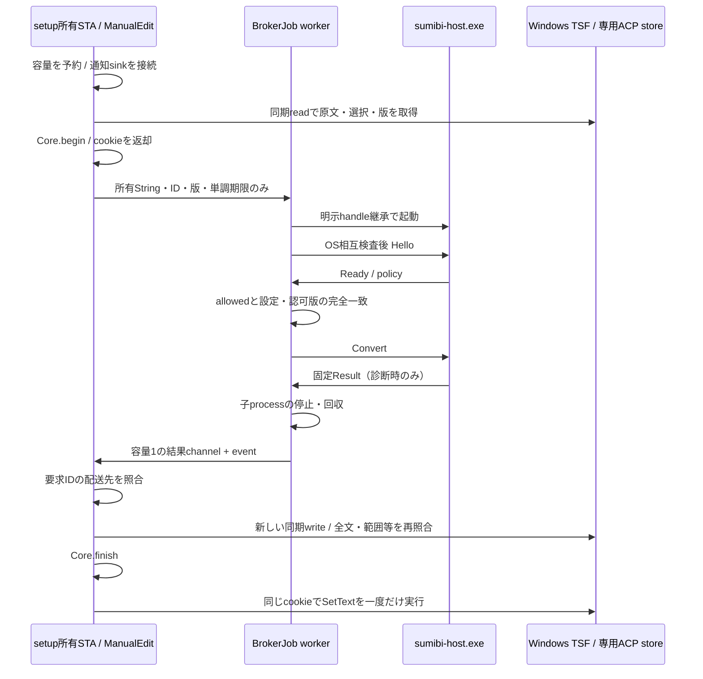

# ADR 0004: 単発Brokerと所有TSFスレッドへの結果配送

2026-10-21 / Issue #4 / PR #10。専用ホストで実装・検証済み。
製品用の常駐Broker、一般アプリ入力、実API通信の採用完了を意味しない。
前提は[ADR 0003](0003-pinned-desktop-peers.md)の固定process handle・token照合と非同期pipe。
本ADRはsetupにリンクした編集アダプターの段階を記録する。後続の実DLLキー接続と非同期デモは
[ADR 0005](0005-dll-key-broker-bridge.md)を参照。

## 背景と今回の判断

従来の親子process診断はCoreの模擬対象までで、実TSFの選択範囲には結果を戻していなかった。
今回は接続・要求・子processを単発ジョブに閉じ、実際のTSF編集までを検証する。
常駐Brokerの発見・複数アプリdispatch・再接続とは別の段階として扱う。

`sumibi-host.exe`を追加する。既定ビルドには有効な変換器がなく、Disabled起動のReadyは
allowed=false。固定結果「日本語」はHostの`spike` featureと明示的な診断モードの両方が必要。
設定・同意の製品実装を省略して一般入力を送信可能にする構成にはしない。
HTTP・資格情報・本文保存は導入していない。

## 起動と相互検査

`ipc/bootstrap.rs`は呼出し側が信頼する絶対実行パスを受け取る。shellを使わず、
CreateProcessWのapplicationを明示し、CREATE_NO_WINDOWで起動する。
UTF-16を損失変換するパス、NUL・引用符を含むパスを拒否する。
これは署名・配置元検査や製品の探索処理を代替しない。

継承リストは親processのquery/synchronize handle、取消event、起動完了eventの3個だけ。
子は継承flagを検査して解除し、必要な権限のhandleを複製する。
pipe名とBroker起動IDはBCryptで作る公開の照合値で、コマンドラインの秘密ではない。
本文をコマンドラインに載せない。標準出力等の余分なhandleを継承リストへ追加しない。

親は自分が起動した子processの実handleを固定し、子は受領した親の実handleを固定する。
子がfirst-instance pipeを作成してから完了eventを通知し、親は接続する。
Helloを含むアプリケーションI/Oの前に、両側でkernel由来の相手PID・作成時刻と
user/logon SID・Windows session・medium integrity等を照合する。PID引数を信頼しない。

## 有限容量・取消・終了

| 資源 | 上限と所有 |
| --- | --- |
| 単発ジョブ | 呼出しprocess内で合計4。未起動のReservationも数える |
| ジョブの子process・worker | 各最大1。予約をworker終了まで保持 |
| pipe | 従来どおりprocess合計8 endpoint。各pipeで同時I/O最大1 |
| 要求・結果 | 各ジョブ1要求・結果channel容量1。結果にDebugを実装しない |
| 本文 | 原文・結果とも1024 UTF-16単位。JSON外枠は256KiB |
| 期限 | 所有側の絶対単調期限、最大60秒。起動待ちも同じ期限を消費 |

容量は選択取得や変換キー消費より前に予約する。現在のbroker-testはキーを消費しない。
I/O、子の起動待ち、子の回収はworkerが実行し、COMオブジェクトを移動しない。
ワーカーには原文Stringと不透明なID・版・期限だけを渡す。

取消はまず所有側のManualEditを破棄して適用権を失効させ、Stop eventを通知する。
Stopはclientのread/writeと子の診断待機に共通で、blocked readの後ろにCancelを積まない。
この単発経路は接続を終了し、要求・本文を自動再送しない。
常駐接続のCancel/policy_changed等を実装した汎用serverではない。

BrokerJobのDropはevent通知だけで待たない。明示shutdownはwindow/TSF callbackの外で行う。
子のguardは停止通知後1秒待ち、反応しなければ自分が起動したその子だけを終了して再度1秒待つ。
結果通知より先に子とpipeを解放する。子の通信中は親processの終了も検出し、応答後の待機も
Stopまたは親process終了で解除する。通信・待機には有限期限を設ける。
OS操作が成功しない場合のプロセス消滅まで保証した、という意味ではない。

## 所有スレッドでの再検査

`tip/manual_edit.rs`のManualEditはRcとCOM参照を保持する単発ticketで、別threadへ送れない。
登録IDはCOMアドレスではなく、呼出し側が再利用しない不透明な値。
今回のアダプターは**呼出し側が所有するACP text store**だけに限定する。
ITfRangeACP座標を一般アプリの文書へそのまま適用する根拠にはしない。

取得前からITfTextEditSinkとITfThreadMgrEventSinkを接続し、任意のwrite完了や
文書・context・フォーカスの通知で永久に失効する。本文・選択を変更後に元へ戻しても復活しない。
sinkは弱参照と独立ObjectLeaseを持つ。unadvise失敗でもCore ticketを復活させず、DLL寿命を守る。
読取セッション完了はOnEndEditの対象ではないため、取得それ自体で正常要求を失効させない。

所有loopはeventとWindows messageをMsgWaitForMultipleObjectsExで待ち、callbackの外で結果を取り出す。
結果を配送する前に要求IDを照合する。旧要求の結果で新要求のticketを取り出さない。
HWNDや生ポインターをworkerのメッセージpayloadにしない。

適用は新しい同期writeセッションで、許可・版・期限・フォーカスcontext・選択範囲と向き・
全文UTF-16を再確認する。Core.finishへ渡すTargetもその場で再取得し、再入後の観測を再検査する。
Coreが許可した本文を同じセッション内で一度だけSetTextする。
同期ロック拒否や不明な読取で後続の非同期書込を予約せず、元の本文を保持する。
終了・取消時にticketを破棄する責任は所有側にある。

## 検証記録と残作業

2026-10-21、Windows 11 x64 / 10.0.26300 / 通常ユーザー・medium / Rust 1.99.1。
`broker-test`で実Windows TSFと別sumibi-host.exeを使い、合成本文のみで19ケースが成功した。

- 正常な部分置換と専用storeの1回Undo。
- 取消、window破棄、新要求に対する旧結果の破棄。
- 同長別本文、本文変更後の復元、選択変更、選択変更後の復元、フォーカス移動後の復帰。
- 認可取消、設定変更、読取専用、writeロック拒否、読取不能、期限切れ。
- 異なる要求ID、異なる入力版、Disabled、Readyの設定版不一致。

TSF/COM解除とDLLアンロード検査も成功。既存ipc-peer-testの14確認も再実行して成功した。
workspaceテストにジョブの容量・起動前の値検査2件を加え、単体・結合テスト合計36件。
個別手順は[DEVELOPMENT](../DEVELOPMENT.md)へ記載する。

この試験は所有STAにリンクした編集アダプターを通る。実DLLの予約キーからこのBroker経路を
起動した試験ではなく、既存demoのF7も従来の固定変換のまま。
常駐Broker、複数アプリ、製品InputSession/composition、機密スコープ判定、実打鍵、一般アプリの標準Undo、
HTTP・同意UI・設定保存・資格情報は引き続き未実装／未検証。Issue #4は完了として扱わない。

根拠: [OnEndEdit](https://learn.microsoft.com/en-us/windows/win32/api/msctf/nf-msctf-itftexteditsink-onendedit)、
[GetExtent](https://learn.microsoft.com/en-us/windows/win32/api/msctf/nf-msctf-itfrangeacp-getextent)。
