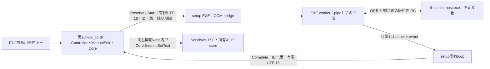

# ADR 0005: 実DLLのキーから単発Brokerへ接続する診断用bridge

2026-10-21 / Issue #4 / PR #10。専用ACP入力欄で実装・検証済み。
[ADR 0004](0004-one-shot-broker-and-owner-edit.md)の、setupにリンクしたManualEditから進め、
実際にロードしたsumibi_tip.dll内のキーcallback・Core・編集アダプターを通す。
製品の通常入力・常駐Broker・実API通信の完了を意味しない。

## 判断と責務

DLLへ直接バックグラウンドthreadを追加すると、解除後もthreadがDLL内のコードへ復帰し得る。
単なるCOMオブジェクト数の確認だけでは、threadの最後の命令やアンロードとの競合を解決できない。
今回の専用診断では、明示的に接続するEXE実装のtransport callbackを使用する。
通信workerと子processの回収はEXEのコードで完結し、workerからDLL callbackを呼ばない。
DLLは所有STAで選択を取得・保持し、応答の適用もDLL内で行う。

この選択は、一般アプリに同じEXE callbackが存在すると仮定するものではない。
製品BrokerClientの配置・発見と、一般アプリ内の非同期実行／DLL寿命は後続の設計・受入条件である。

## 新しい診断ABI

`spike` feature内の別GUIDとしてISpikeBrokerとISpikeBrokerTransportを追加する。
既存ISpikeControl/ISpikeDelayedのvtableを拡張しない。既定TIPにはこれらを公開しない。
Attachは呼出し側が所有するACP contextとtransportの明示登録であり、機密スコープ判定や
外部送信への同意として使用しない。fixture policyのsettings/authorizationは1に固定する。

| ABI | 契約 |
| --- | --- |
| Attach | この診断contextに限って接続。旧対象と旧transportを先に失効させる |
| Reserve | 有限容量を予約し、単調増加の非ゼロIDを返す。本文取得より先 |
| Start | 取得済み原文、ID・版・残り最大5秒を渡す。UTF-16ポインターは呼出し中だけ借用 |
| Complete | 先にIDを照合し、対応するticketだけを消費。版・期限・現在対象はDLL内で再検査 |
| Cancel | 先に所有ticketを破棄し、その後transportの予約解放／event通知。I/O完了を待たない |
| Pending | 本文を返さず、所有要求のIDだけを照会 |

RustのString/Vec、allocator所有権、COMターゲット、cookie、範囲座標をABIやworkerへ渡さない。
文字列は非空・1024 UTF-16単位以下・正しいUTF-16を検査し、受け手が呼出し中に所有コピーを作る。
平坦な整数フィールドを使い、Rust構造体のレイアウトを共有しない。生ポインターは信頼する診断用
同一STAのCOM callerが有効なバッファ／interfaceを渡す契約であり、任意アドレスの安全な検査ではない。

## ID・失効・再入とDLL寿命

bridgeのIDはEXE process内で単調増加し、bridgeを作り直しても再利用しない。
DLLのControllerも寿命全体の受入下限を保持し、Attach/Grant/Revokeで番号をリセットしない。
旧bridgeの結果が新しい接続の同番号要求へ適用されることを防ぐ。
さらにProtocolのsession・Broker boot IDはジョブごとに新規生成する。名前やIDをOS認証には使わない。

Controllerは二重要求を本文再取得前に拒否する。本文・選択変更、フォーカス喪失、許可取消、
Esc、Enter、終了でticketを失効させる。Enterは原文のままホストへ一度だけ通す。
フォーカス・原文・選択を元に戻しても旧ticketを復活させない。
対応する不正結果・版不一致は終了し、無関係なIDは現在要求を消費しない。

取消はRefCellからticketを取り出してからCOMを呼び、借用を保持して再入しない。
Revokeでは外部呼出し前に許可とbroker接続を失効させ、入れ子のbusy状態を復元する。
独立control、sink、編集Sessionが各ObjectLeaseを保持する。controlはControllerへの弱参照であり、
Controller消滅後は新規処理を拒否し、残ったcontrol自身の解放までDLLをアンロード不可にする。
所有thread検査は弱Rcへ触れる前に行う。

bridgeはDLLのcontrolを保持しない。所有loopがcontrolとbridgeを保持し、workerには両方とも渡さない。
結果channelから取り出した後、所有loopが同期的にCompleteを呼ぶ。
Dropによる取消はevent通知だけで、明示shutdownはWndProc/TSF callbackの外で行う。
停止・有限I/O・子processの回収条件はADR 0003/0004を引き継ぐ。

## 試用できる非同期デモ

`sumibi-setup broker-demo --dll ...`は既存の1行Editorを使い、F7でこのbridgeを接続する。
未選択なら全文、選択中なら選択範囲を対象にする。F7の明示操作時だけ自分のcontextへ許可を与える。
400msの固定診断結果を別Hostから受け取る。待機中も文字入力・移動・取消・終了を処理できる。
Escで取消、Enterで原文確定、Ctrl+ZでUndo。F6の下線プレビューはこのデモでは使用しない。
従来の`demo`のF6/F7経路は維持する。

所有loopはeventとWindows messageを同時に待ち、結果をWndProcの外で適用する。
終了前にDLLの許可を取り消し、閉じたviewへ結果を配送しない。
同期SC_CLOSEからの延期された終了通知も待機を解除する。WM_QUITも待機終了の条件として扱う。
このデモに候補UI、ネットワーク、本文保存、パスワード欄の自動判別はない。

## 検証記録

2026-10-21 / Windows 11 x64 build 26300 / 通常ユーザーmedium / Rust 1.99.1。

- broker-key-testの17ケース：正常・二重キー・容量不足・Esc・Enter・原文復元・選択復元・
  focus復帰・readonly・write拒否・許可取消・旧結果・transport付替え・版不一致・不正UTF-16結果・Disabled・終了。
- 通常は実TSFのSimulatePreservedKeyからDLLへ配送する。容量不足の本文取得回数は、Windows自身の
  metadata取得と分離するため、同じDLLのOnPreservedKey callbackを直接呼んで測定する。
  Esc/Enterも診断用の同じDLL callbackを使う。物理キーボードや前面化の許可を試した記録ではない。
- broker-input-testの6ケース：F7非同期結果と描画・1回Undo、Esc、Enterがホストへ1回、
  待機中の本文編集、通常終了、変換待ち中の同期SC_CLOSE。
  最後のケースはbroker-demoそのものの待機loopを使い、watchdog付きで停止を検出する。
- COM既存テスト内で新controlの独立lease、Controller消滅後の拒否、別threadでの事前拒否を追加。
  workspaceは合計36件のまま。通常のCOMマーシャリングを試した意味ではない。
- 専用processのTSF/COM解除・DLLアンロード検査が成功。
- Test-Spike.ps1 -SkipDesktopで36件・fmt・各構成Clippy・ビルド・load_smoke・self/edit/key検査が成功。
  既存broker-testの19ケースとclose-testの4ケースも別途実行して成功した。
  最終の新経路試験後に、診断Host/Setup processが残っていないことも確認した。

合成本文のみを使う。一般アプリのcomposition、実打鍵、標準Undo、機密欄、常駐Brokerのdispatch、
HTTP・製品同意・設定・資格情報は引き続き未実装／未検証。Issue #4は完了として扱わない。
