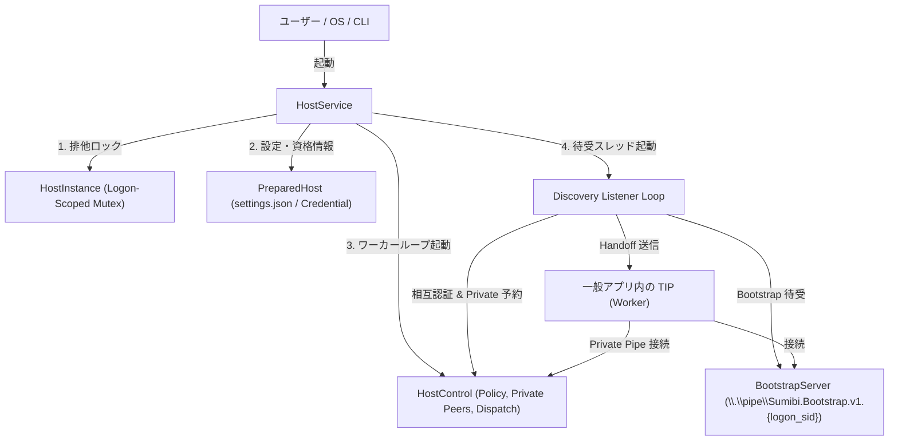

# ADR 0086: 常駐 Host のログオン限定待受ループと停止調停 (HostService)

作成日: 2026-11-02 / Issue #4 / draft PR #10
状態: 策定・実装

## 1. 背景と課題

ADR 0084 で `HostControl` ワーカーループへの peer 受付と変換ディスパッチを統合し、ADR 0085 でログオン限定ブートストラップ待受による Host / TIP 相互発見プロトコルを策定・実装した。
さらに、TSF キー変換パイプラインにおいてブートストラップ待受と Worker 接続がエンドツーエンドで動作することを検証した。

しかし、製品として `sumibi-host.exe` が常駐稼働し、一般アプリ内の TIP（Notepad, エクスプローラー等）からの接続を受け付け続けるためには、以下の課題を解決する製品エントリー層（`HostService`）が必要である：

1. **連続的な Discovery 待受**:
   単一のブートストラップ接続で終了せず、クライアントが接続・ハンドオフされるたびに即座に次の待受インスタンスを確保し、複数の一般アプリからの発見要求を途切れることなく受け付け続ける待受ループ。
2. **完全な停止調停（Graceful Teardown）**:
   OS ログオフ、Ctrl+C、あるいは UI/コマンドからの終了シグナルに対して：
   - 待受中のブートストラップパイプを即座に安全にクローズ（CancelIoEx）。
   - 進行中の変換要求（in-flight jobs）を期限内で安全に完了（drain）。
   - 単一起動ミューテックス（`HostInstance`）を解放し、リソースリークなくクリーンに終了。
3. **二重起動と孤立プロセスの排除**:
   同一ログオンセッション内で複数の Host が立ち上がらないよう、ADR 0074 の `HostInstance` による非ブロッキング排他を強制する。

## 2. アーキテクチャと設計

### 2.1 `HostService` の構造

### 2.2 待受ループのライフサイクル (`Discovery Listener Loop`)

1. **待受インスタンスの先行確保**:
   - `BootstrapServer::create(&pipe_name, MAX_INSTANCES)` で第 1 インスタンスを作成。
   - ループごとに、現在のインスタンスを `accept` に渡す前に、`additional()` を呼び出して次の待受インスタンスを準備する。これにより、クライアントの接続処理中もパイプ名が維持され、別アプリからの接続要求が拒否（`ERROR_FILE_NOT_FOUND` / `ERROR_PIPE_BUSY`）されない。
2. **接続受付とハンドオフ**:
   - `server.accept(&stop, deadline)` で接続を待機。
   - 接続後、カーネルからクライアント PID を取得し、`PinnedProcess::from_peer_pid` で相互検証。
   - `HostControl::try_accept_private_peer` で一回限りプライベートパイプ名を発行。
   - `handoff::send` でクライアントに転送し、ブートストラップパイプを正常終了。
3. **安全なキャンセル**:
   - `stop.cancel()` が発行されると、OVERLAPPED I/O が `CancelIoEx` されて `accept` は即座に `Err(Error::Cancelled)` で安全にループを脱出する。

### 2.3 停止調停（Graceful Teardown）

`HostService::stop` または `shutdown`:
1. `stop.cancel()` を発行し、待受スレッドを起床・終了。
2. `HostControl::try_close()` を発行し、ワーカーループに停止を通知。
3. `HostControl` は進行中の変換ジョブをドレインし、登録されたプライベートパイプをクローズ。
4. ワーカースレッドの `join` 完了を待機。
5. `HostInstance` が drop され、ログオン限定ミューテックスが解放される。

### 2.4 CLI コマンド統合

`sumibi-host.exe run [settings-path]` (または `service`):
- 常駐サービスとして起動し、コンソールイベント（Ctrl+C）ハンドラを登録。
- 終了シグナル受信時に `HostService` の停止調停を呼び出し、コード 0 で終了。

## 3. 利点と保護保証

1. **ゼロ・トラストと自動発見の両立**:
   一般アプリはログオン SID にバインドされた固定パイプを通じていつでも安全に Host を発見でき、Host 側は自動的にプライベートパイプへ誘導する。
2. **完全なリソース隔離とクリーンアップ**:
   クラッシュや異常終了時も OS がログオンミューテックスとパイプハンドルを解放し、次回起動を妨げない。
3. **TSF STA への非ブロッキング保証**:
   待受・ハンドオフ・変換のすべての段階において、一般アプリ側の TSF UI スレッドをブロックしない。
