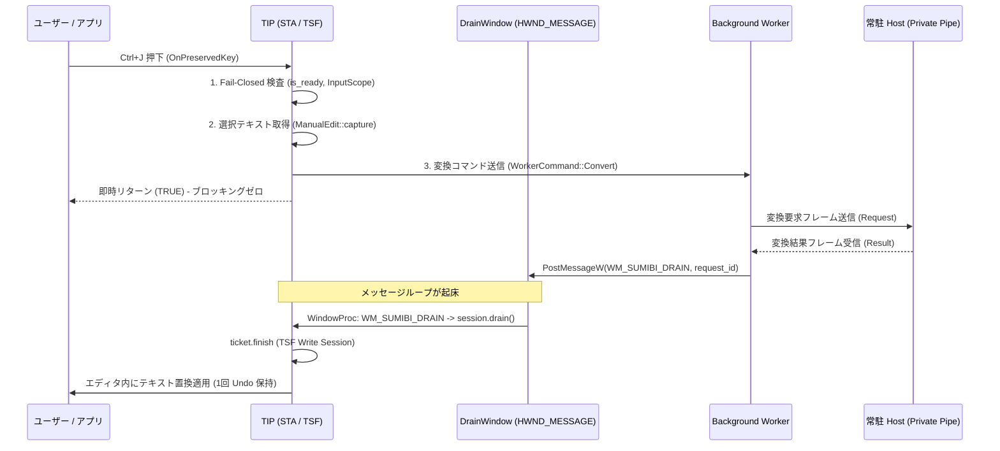

# ADR 0088: メッセージ専用ウィンドウによる STA 非同期完了通知とテキスト自動適用 (AsyncDrain)

作成日: 2026-11-02 / Issue #4 / draft PR #10
状態: 策定・実装

## 1. 背景と課題

ADR 0087 において、TSF 所有 STA スレッドの完全な非ブロッキング化と、バックグラウンドワーカーによる自律 Host 発見・変換ディスパッチ（`TipHostSession`）を確立した。

しかし、バックグラウンドスレッドで変換結果（`WorkerEvent::Completed`）を受信した後、エディタにテキストを反映（`ManualEdit::finish`）させるには、TSF の COM 制約により**必ず STA スレッド上で**非同期編集セッションを要求して実行する必要がある。

一般アプリケーション（Notepad、エディタ、ブラウザ等の Windows アプリ）では、メインスレッド（STA）は Win32 メッセージループ（`GetMessage` / `DispatchMessage`）でアイドル待機している。したがって、バックグラウンドスレッドから STA スレッドを安全に起床させ、`TipHostSession::drain()` を呼び出さなければ、ユーザーが次のキーを押すまで結果が反映されない。

また、`PostThreadMessageW` はモーダルループ中（ダイアログやメニュー表示中）にメッセージが破棄される既知の Win32 制約があるため、メッセージの確実な配送には「メッセージ専用ウィンドウ（Message-Only Window）」が必要である。

## 2. アーキテクチャと設計

### 2.1 メッセージ専用ウィンドウ (`HWND_MESSAGE`)

### 2.2 ライフサイクルと保護保証

1. **ウィンドウの生成と所有**:
   - `TipHostSession::start` 時に STA スレッド上で固有のウィンドウクラスを登録し、親ウィンドウとして `HWND_MESSAGE` を指定したメッセージ専用ウィンドウを作成。
   - 画面には一切描画されず、タスクバーやウィンドウ一覧にも現れない。
   - `GWLP_USERDATA` にセッションの参照（ポインタ）を設定。
2. **非ブロッキング非同期通知**:
   - バックグラウンドワーカーは変換完了イベントをチャネルに投入した後、`PostMessageW(hwnd, WM_SUMIBI_DRAIN, request_id, 0)` を呼ぶ。
   - `PostMessageW` は OS のメッセージキューへ投げるだけの非ブロッキング呼び出しであり、STA がどんな状態であってもワーカーを停止させない。
3. **STA 側での自動反映 (`drain`)**:
   - 一般アプリのメッセージループが `WM_SUMIBI_DRAIN` を取得し、WindowProc にディスパッチ。
   - WindowProc 内で `session.drain()` を呼び出し、保留中のチケット（`ManualEdit`）に対して `ticket.finish` を実行。
   - TSF の Write セッション内でテキストが置換され、1 回 Undo（Ctrl+Z）が保証される。
4. **安全な破棄 (`close`)**:
   - `TipHostSession::close` または `Drop` 時に、STA スレッド上で `DestroyWindow` を呼び出し、ウィンドウクラスの登録を解除する。
   - `WM_NCDESTROY` で `GWLP_USERDATA` をクリアし、破棄後の不正ポインタ参照（dangling pointer）を構造的に防止。

## 3. 利点と保護

1. **完全な STA 起床**:
   一般アプリのメッセージループを即時に起床させ、ユーザーの追加打鍵なしに変換結果を自動反映できる。
2. **モーダルループ耐性**:
   `PostThreadMessage` と異なり、Win32 のメッセージ専用ウィンドウはモーダルループ中であってもメッセージが破棄されない。
3. **Fail-Closed な安全性**:
   万一ウィンドウ破棄やメッセージ遅延が発生した場合でも、キーストローク時（`OnPreservedKey`）にフォールバック `drain` が動作する。また、フォーカス移動やコンテキスト破棄が発生していれば `ManualEdit` の内部保護判定によって安全に自動破棄（キャンセル）される。
